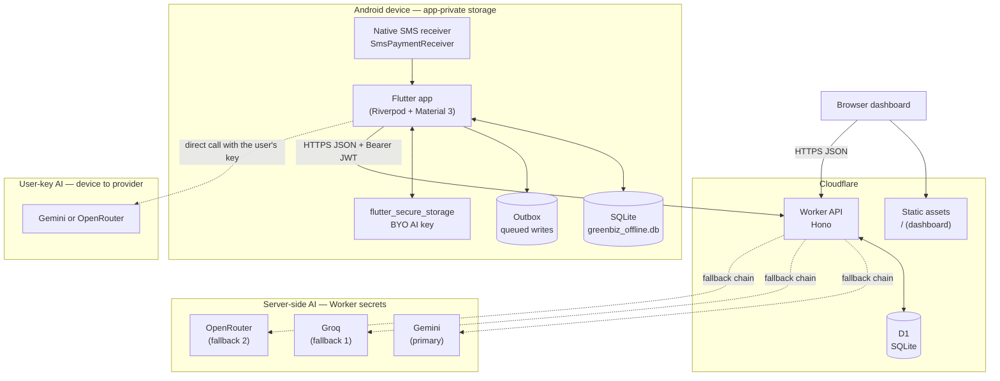
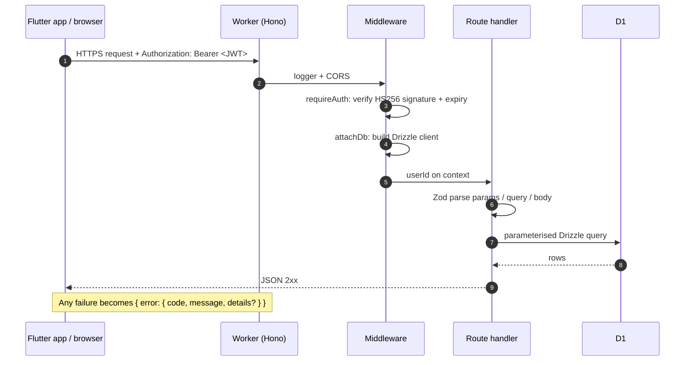
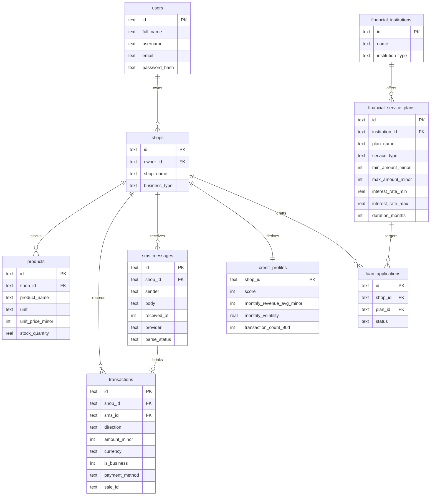
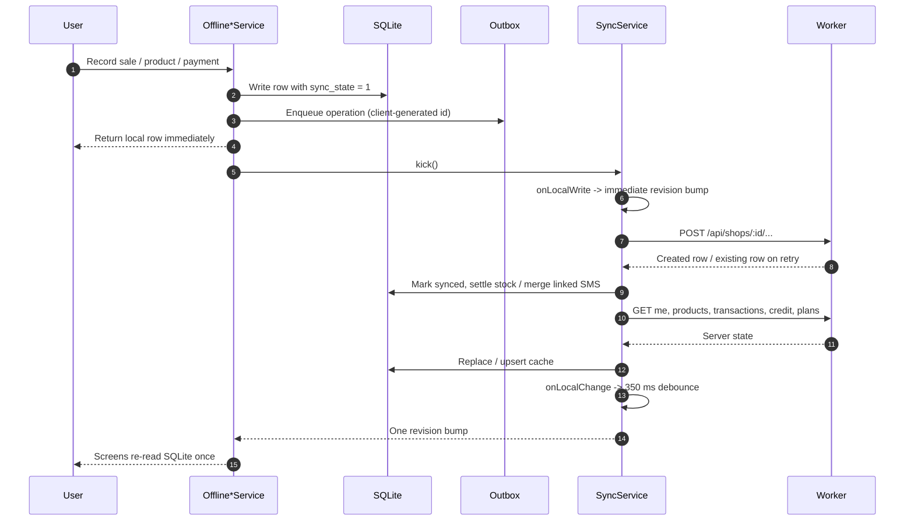
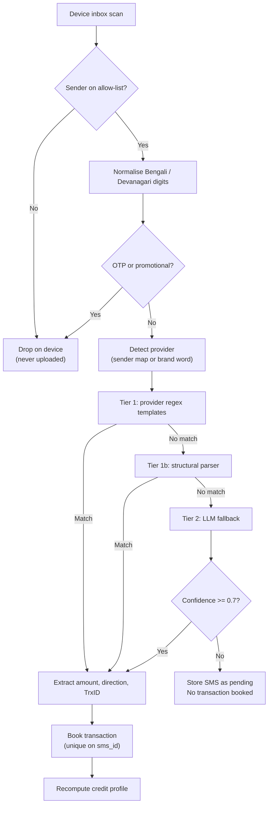
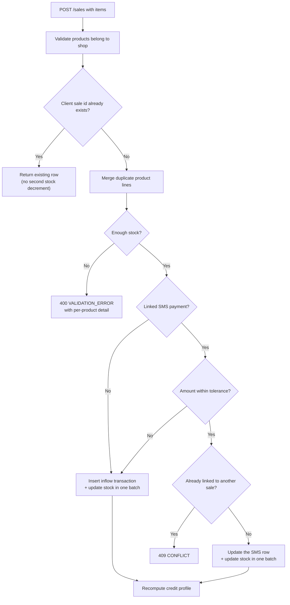
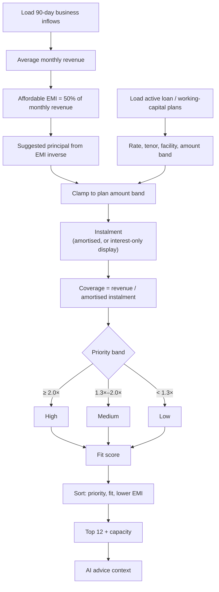
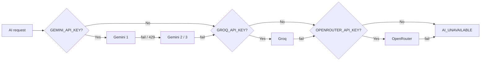
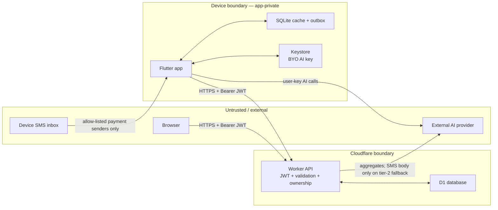

# GreenBiz — Technical Documentation

> **Product:** GreenBiz — SME Finance Copilot for Bangladesh and India
> **Clients:** Flutter Android app, single-page browser dashboard
> **Backend:** Cloudflare Worker (Hono) + D1 (SQLite)
> **Last updated:** 2026-10-18
> **Audience:** engineers, reviewers, and anyone evaluating the system's correctness, privacy, or security posture

---

## Contents

1. [Product overview](#1-product-overview)
2. [System architecture](#2-system-architecture)
3. [Core algorithms](#3-core-algorithms)
4. [Security design](#4-security-design)
5. [Operations and deployment](#5-operations-and-deployment)
6. [API surface](#6-api-surface)
7. [Testing strategy](#7-testing-strategy)
8. [Known limitations and residual risks](#8-known-limitations-and-residual-risks)
9. [File map](#9-file-map)

---

## 1. Product overview

GreenBiz helps a very small business owner answer four questions:

1. **What do I sell, and how much stock is left?** — inventory and sales.
2. **What money actually moved?** — payments imported from bKash, Nagad, Rocket, Upay and bank SMS, plus manual entries.
3. **How does my business look to a lender?** — a rule-based, explainable credit profile.
4. **Which loan product could I comfortably repay?** — affordability matching across 39 real Bangladeshi SME products.

The app is **offline-first**. Every screen reads from a local SQLite database; the Worker is a sync target, not a dependency. A shop owner can record a sale, add a product, or review payments with no network at all. The outbox retries writes when connectivity returns.

### Design principles

| Principle | What it means in the code |
|---|---|
| **Offline-first** | `lib/core/local_db.dart` is the read path. Writes go local + outbox, then `SyncService.kick()`. |
| **Integer money** | Every amount is an integer in minor units (poisha/paisa). No floats on the money path. |
| **Explainable algorithms** | Credit scoring and loan matching are rule-based and return `reasons[]`, not an opaque score. |
| **Privacy by construction** | The device filters the SMS inbox to known payment senders before anything is uploaded. |
| **One error contract** | Every API failure is `{ error: { code, message, details? } }`. |
| **One source of truth per concern** | D1 for shared state, SQLite for the device working copy, Worker secrets for credentials. |

### Technology stack

| Layer | Technology |
|---|---|
| Mobile client | Flutter 3.47 / Dart 3.13, Riverpod 3, Material 3 |
| Local persistence | `sqflite` (SQLite), `shared_preferences`, `flutter_secure_storage` |
| SMS access | `flutter_sms_inbox` (inbox scan) + native Android `SmsPaymentReceiver` (live alerts) |
| Backend | Cloudflare Workers, Hono, zod, Drizzle ORM |
| Database | Cloudflare D1 (SQLite) |
| AI | Gemini (primary), Groq (fallback), OpenRouter (fallback); optional user-owned key for sale/scan |
| Web dashboard | Vanilla HTML/CSS/JS served by the Workers assets binding |

---

## 2. System architecture

### 2.1 High-level topology



**Why this shape?**

- The Worker holds **all server credentials**. The client bundle contains none.
- The device keeps a **working copy** so the UI never waits for a network round trip.
- AI is split into two trust domains:
  - **Server AI** for SMS fallback and finance advice, paid for by the Worker's keys.
  - **Bring-your-own-key AI** for the sale assistant and product scan, paid for by the owner and never routed through GreenBiz.

### 2.2 Component responsibilities

| Component | Responsibility | Key files |
|---|---|---|
| **Flutter UI** | Tabs, sale flow, payment sheet, reports, profile | `lib/features/**` |
| **Riverpod graph** | Dependency wiring, offline services, providers | `lib/core/providers.dart`, `lib/features/**/*_controller.dart` |
| **SQLite cache** | Account, shops, products, transactions, credit JSON, plans, outbox | `lib/core/local_db.dart` |
| **Sync engine** | Push outbox, pull server state, retry, revision signal | `lib/services/sync_service.dart`, `lib/features/sync/` |
| **Native SMS bridge** | Receive live payment SMS, parse, notify, queue | `android/app/src/main/kotlin/com/asrumon/greenbiz/` |
| **Worker API** | Auth, validation, ownership, business rules | `greenbiz/src/routes/**`, `greenbiz/src/middleware/**` |
| **Domain services** | SMS parsing, credit score, loan math, plan matching, AI chain | `greenbiz/src/services/**` |
| **D1** | Shared relational state, unique constraints, migrations | `greenbiz/src/db/` |
| **Dashboard** | Browser view of the same account and API | `greenbiz/public/index.html`, `public/_headers` |

### 2.3 Request lifecycle

Every authenticated API call follows the same path.



Two details matter:

- **`attachDb` runs before route handlers**, so no handler touches `env.DB` directly.
- **`onError` is the only place that formats errors.** An expected `AppError` is returned with its message; an unexpected error is logged server-side and returned as a generic `INTERNAL` response. Stack traces and D1 driver messages never reach the client.

### 2.4 Data model



Rules encoded in the schema:

- **Money is `INTEGER` minor units.** `stock_quantity` and interest rates are the only `REAL` values.
- **One SMS can book at most one transaction.** Unique index on `transactions.sms_id`.
- **One client sale can create at most one transaction row.** Unique index on `transactions.sale_id`.
- **One SMS is unique per shop, sender, body and timestamp.** This is the bulk-upload idempotency key.
- **Deleting a shop cascades** to its products, transactions, SMS rows and credit profile.
- **`loan_applications` exists but has no routes yet.** It is intentionally a draft table for a future application flow.

### 2.5 Offline write and sync path



**Idempotency is layered:**

| Operation | Idempotency key |
|---|---|
| Product create | client-generated `id` |
| Transaction create | client-generated `id` |
| Sale | client-generated `id` stored as `transactions.sale_id` |
| SMS upload | unique `(shop_id, sender, body, received_at)` |
| SMS → transaction | unique `transactions.sms_id` |

**UI refresh contract**

A burst of local changes must not turn into a burst of reloads. `DataRevision.bump()` is a **350 ms trailing debounce**; `bumpNow()` is immediate and is used after a user write. Data providers watch `dataRevisionProvider` and re-read SQLite. `AsyncSection` keeps the previous data visible while a provider reloads (`skipLoadingOnRefresh` + `skipLoadingOnReload`), so a refresh updates content without a spinner flash.

### 2.6 Deployment topology

| Environment | Worker | Database | Client configuration |
|---|---|---|---|
| **Local** | `wrangler dev` on `127.0.0.1:8787` | Local D1 under `.wrangler/state` | `--dart-define=GREENBIZ_API_URL=http://10.0.2.2:8787/api` |
| **Production** | `https://greenbiz.asrumon.workers.dev` | Remote D1 `greenbiz_db` | Default `Env.apiBaseUrl` (HTTPS) |

- Release builds **block cleartext HTTP** via `network_security_config.xml`.
- Debug builds permit cleartext so the emulator can reach `wrangler dev`.
- The web dashboard is served by the Workers **assets binding** at `/`; only `/api/*` reaches the Worker.
- Android is the only platform with SMS inbox access. iOS, Windows, macOS and Linux are scaffold/platform targets; the SMS feature is Android-only.

---

## 3. Core algorithms

### 3.1 Money representation

All amounts are integers in minor units:

- BDT: **poisha** — `৳1,500.00` is `150000`.
- INR: **paisa** — `₹1,500.00` is `150000`.

There is no float on the money path. Decimal input is parsed by splitting the integer and fraction strings, never by `parseFloat`:

```ts
// greenbiz/src/services/smsParser/patterns/shared.ts
const match = /^(\d+)(?:\.(\d{1,2}))?$/.exec(raw.replace(/[,\s]/g, ""));
return Number(match[1]) * 100 + Number((match[2] ?? "").padEnd(2, "0"));
```

A third decimal place is rejected rather than truncated: `1.005` is not representable in paisa.

### 3.2 SMS parsing pipeline

The parser is **three tiers**, arranged so the cheapest and most predictable path runs first.



#### Tier 1 — provider templates

Known bKash, Nagad, Rocket and UPI layouts are matched by regex. The provider is detected from:

1. the sender shortcode / bank header, or
2. a brand word in the SMS body (survives a changed shortcode or a forwarded message).

Known sender IDs include bKash `16247`, Nagad `16167` (legacy `16248`), Rocket `16222` (legacy `16216` / `16218`), Upay `16268`, and Indian bank suffixes such as `HDFCBK` and `SBIINB`.

#### Tier 1b — structural parser

Provider wording changes frequently, so the structural parser does not depend on a specific template. It looks for the shared shape of a payment message:

```
[provider] [direction phrase] [currency amount] [counterparty] [TrxID] [fee] [balance]
```

Key rules:

- **Amount selection.** Collect every money-looking number, then exclude numbers whose preceding label is `balance`, `available`, `current`, `total`, `wallet`, `fee`, `charge`, `limit` or `due`. Score the remaining candidates by nearby transaction verbs and `to` / `from`, then pick the highest score, earliest on a tie.
- **Direction.** Weighted phrases: `received`, `credited`, `cash in`, `add money` → inflow; `sent`, `cash out`, `recharge`, `bill pay`, `transfer`, `paid` → outflow. The first `from` / `to` after the amount breaks ties.
- **Reference.** `TrxID` / `TxnID` / `Transaction ID` first, then `Ref` / `Reference`.
- **Rejection.** OTPs are rejected. Promotional messages are rejected unless a TrxID is present. An unknown sender needs a TrxID or a provider brand.
- **Confidence.** `0.92` when the direction signal is strong, otherwise `0.80`.

The same algorithm is mirrored in Dart (`lib/core/sms_structural.dart`) for live/offline filtering and in Kotlin (`PaymentSms.kt`) for background alerts.

#### Tier 2 — LLM fallback

Only messages no pattern or structural rule could parse reach a model. The model must return strict JSON:

```json
{
  "direction": "in",
  "amountMinor": 150000,
  "currency": "BDT",
  "counterparty": "017...",
  "reference": "DJG73D7KLD",
  "confidence": 0.94
}
```

- Output is validated with Zod.
- If `confidence < 0.7`, the SMS is stored as **pending** and **no transaction is booked**. A wrong number in a ledger is worse than a missing one.
- If the model says `{ "error": "not_payment" }`, the SMS is stored as `failed`.
- If no AI provider is configured, the SMS is stored as **pending** with `ai_unavailable`; `POST /api/sms/:id/reparse` can retry later.

#### Idempotency

The SMS insert uses `ON CONFLICT DO NOTHING` on `(shop_id, sender, body, received_at)` and `RETURNING`. An empty result **is** the duplicate signal. Booking a transaction uses the unique `sms_id` index the same way. Re-uploading an inbox, or reparsing a message, cannot double-book money.

### 3.3 Sale atomicity and payment matching

A sale writes two things that must never disagree:

1. money coming in (one `transactions` row),
2. stock going down (one `products` update per line).

Both are sent in one D1 `batch()`, which is atomic. A failure part-way through leaves neither change applied.



#### Cash-out tolerance

Mobile-money confirmations rarely match the bill exactly: the buyer adds the cash-out charge, or the shop absorbs it. The accepted band is:

$$
\text{tolerance} = \max(100\ \text{minor units},\ 0.02 \times \text{bill})
$$

That is **at least ৳1, or 2% of the bill**:

| Bill | Tolerance | Accepted range |
|---:|---:|---|
| ৳500 | ৳10 | ৳490–৳510 |
| ৳1,000 | ৳20 | ৳980–৳1,020 |
| ৳10,000 | ৳200 | ৳9,800–৳10,200 |

A message inside the band is treated as the same payment and **merges** into the existing SMS transaction; the merged row keeps the amount that actually moved. Outside the band, the sale books its own row and the SMS row is untouched.

The same rule exists in two places, deliberately kept in sync:

- `greenbiz/src/lib/paymentTolerance.ts` (server authority)
- `lib/core/payment_tolerance.dart` (client display and picker)

### 3.4 Credit scoring

The score is rule-based, not ML. Every factor can be explained in one sentence.

$$
\text{score} = 0.30 \cdot C + 0.25 \cdot V + 0.25 \cdot S + 0.20 \cdot A
$$

| Factor | Weight | Definition | Why it matters |
|---|---:|---|---|
| **Consistency** `C` | 0.30 | Inflow spread week to week; score falls as the coefficient of variation rises | A shop with steady daily sales is more predictable than one with a single monthly spike |
| **Volume** `V` | 0.25 | Average monthly inflow against a reference turnover of **2,000,000 minor units** (৳20,000) | Gives the score a scale relative to the target microbusiness |
| **Stability** `S` | 0.25 | Inverse of month-over-month revenue volatility | Rewards revenue that does not collapse from one month to the next |
| **Activity** `A` | 0.20 | Fraction of the 90 days with any recorded activity | Distinguishes an active shop from a dormant account |

Implementation details:

- **Window:** trailing **90 days**, UTC month boundaries.
- **Monthly average divisor:** observed span, floored at 30 days and capped at 90. Extrapolating a monthly figure from three days of sales would inflate turnover by 10×.
- **Business only:** `transactions.is_business = true`. Personal rows stay in the ledger but are excluded from the score and from business cash-flow totals.
- **Risk flags:** `no_activity`, `insufficient_history`, `no_inflow`, `low_activity`, `high_volatility`, `revenue_declining`, `counterparty_concentration`.
- **Persistence:** the result is cached in `credit_profiles` and recomputed after every write that can change it (SMS ingest, transaction create/update/delete, sale).
- **Formula endpoint:** `GET /api/credit/formula` publishes the weights and reference turnover, so the score can be audited by the owner or a reviewer.

The pure function is `computeCredit()` in `greenbiz/src/services/creditScore.ts`; it has no database or clock dependency, which is why it is fully unit-tested.

### 3.5 Loan affordability matching

The catalogue is the **39-product Bangladeshi SME comparison table supplied on 2026-10-18**, across **8 banks**: BRAC, Sonali, EBL, DBBL, Jamuna, Dhaka, Prime and City Bank.

The matcher answers two questions with the same arithmetic:

1. **Which plans can this shop comfortably repay?** → ranked matches with priority bands.
2. **How much can this shop borrow?** → a capacity estimate and a suggested principal.

#### Instalment maths

For an amortising term loan, with monthly rate $r$ and $n$ months:

$$
r = \frac{\text{annual rate (\%)}}{12 \times 100}
$$

$$
\text{EMI} = P \cdot \frac{r(1+r)^n}{(1+r)^n - 1}
$$

The inverse — how much principal a given EMI supports — is:

$$
P = \text{EMI} \cdot \frac{(1+r)^n - 1}{r(1+r)^n}
$$

For a revolving, interest-only or bullet facility, the displayed monthly cost is interest only:

$$
\text{EMI}_{\text{interest}} = P \cdot r
$$

Affordability for a revolving line is still tested **as if the principal were repaid over the renewal period**, otherwise every cash-credit facility would look 30× affordable.

#### Priority bands

The product rule is: revenue covering the instalment **twice or more is high priority**.

| Monthly revenue ÷ instalment | Band | UI label |
|---:|---|---|
| **≥ 2.0×** | High | “High priority” |
| **1.3× – 2.0×** | Medium | “Good fit” |
| **< 1.3×** | Low | “Stretch” |
| no published rate | Unknown | “Terms on request” |

A small epsilon (`0.005`) absorbs rounding so a true 2.00× is never labelled “medium” because it computed as 1.9999.

#### Capacity estimate

$$
\text{Affordable EMI} = 0.50 \times \text{average monthly business revenue}
$$

The suggested principal is the largest amount that fits inside a real product band:

1. compute the affordable principal from the plan's lowest stated rate and published tenor,
2. clamp it to `[minAmountMinor, maxAmountMinor]`,
3. round **down** to a whole thousand taka so the instalment never exceeds the 50% ceiling,
4. prefer the largest high/medium-priority **term** plan with tenor ≤ 72 months,
5. if no product can be sized, return a labelled **12% / 36-month benchmark**.

#### Ranking

Each match is scored 0–1:

| Component | Weight | Measure |
|---|---:|---|
| Affordability | 0.55 | `min(coverage / 3, 1)`; 3× cover is full marks |
| Cost | 0.25 | Lower stated annual rate scores higher |
| Institution trust | 0.12 | Commercial bank > NBFI > MFI; published source URL adds weight |
| Eligibility fit | 0.08 | Penalties for amount outside the band, revenue below the product minimum, or business age below the stated minimum |

Matches are sorted by **priority first**, then fit score, then lower instalment. The API returns the top 12 plus the capacity estimate.



Every match carries:

- `reasons[]` — the instalment, coverage multiple, suggested amount, and why it was ranked;
- `requirements[]` — collateral, guarantees, business age, trade licence, age limits, women-led status;
- `warnings[]` — amount outside the band, revenue below the product minimum, recorded history shorter than the stated business age.

The app calls every figure an **estimate**. Collateral, CIB history and documents are listed as requirements, not verified.

### 3.6 AI features

There are two AI trust domains.

#### Server-side AI

Used by:

- **SMS tier-2 fallback** — extracts structured payment fields from an unrecognised message.
- **Finance advice** — `POST /api/ai/recommend` builds a context of aggregates (score, monthly revenue, inflow/outflow, product count, stock value, loan capacity, top matched plans) and asks for a short plain-language answer.

Provider chain, built per request and never cached:



- Keys live only in Worker secrets / `.dev.vars`.
- Provider failures log the provider name and message only — never the key, the request URL, or the full prompt.
- `GET /api/ai/status` returns a boolean, never a provider name or key fragment.
- The model output is validated with Zod; confidence gates prevent a guess becoming booked money.

#### Client-side AI (bring your own key)

- **Sale assistant** — two passes: transcript → search terms → local candidate products → final line items with quantities. Runs with the owner's own key stored in the platform keystore.
- **Product scan** — a compressed camera photo is sent directly to the owner's chosen provider; the image never reaches the GreenBiz Worker.

This keeps the server's AI quota separate from the owner's, and means the voice/photo flows work even if the Worker has no AI key.

### 3.7 Client refresh and data revision

The visible symptom this design prevents is a screen that reloads three or four times before the owner touches anything.

| Mechanism | Behaviour |
|---|---|
| `DataRevision.bump()` | 350 ms trailing debounce; coalesces a burst of writes into one refresh |
| `DataRevision.bumpNow()` | Immediate; used after a user write |
| `SyncService.onLocalWrite` | Immediate revision signal from `kick()` |
| `SyncService.onLocalChange` | Debounced signal after a pull or background prefetch |
| `activeShopIdProvider` | Data providers watch the stable id, not the `Shop` object, so auth refreshes do not reload data |
| `AsyncSection` | `skipLoadingOnRefresh` + `skipLoadingOnReload`: keeps existing content visible during a reload |
| Cache-first credit/plans | Credit profile, matched plans and the plan directory render from cache immediately, then refresh in the background |

Only one startup sync runs: `HomeShell` starts it, `SyncController._bootstrap` does not, and the synthetic cold-start `resumed` lifecycle event is ignored.

---

## 4. Security design

### 4.1 Threat model and trust boundaries



The main assets to protect are:

1. **Account access** — a stolen token must not expose another shop.
2. **Commercial data** — inventory, prices, transactions, credit profile.
3. **Restricted PII** — raw SMS bodies, counterparty phone numbers, TrxIDs.
4. **Server credentials** — JWT secret, admin token, AI provider keys.
5. **AI quota** — an unauthorised caller must not be able to drain the Worker's keys.

### 4.2 Data classification

| Class | Examples | Who can read it | Where it lives |
|---|---|---|---|
| **Public** | Plan directory, institution list, scoring formula | Anyone, no auth | `financial_institutions`, `financial_service_plans` |
| **Account** | Name, username, optional email, shop profile | The owner only | `users`, `shops` |
| **Commercial** | Inventory, prices, transactions, credit profile | The owner only | `products`, `transactions`, `credit_profiles` |
| **Restricted (PII)** | Raw SMS bodies, counterparty phone numbers, TrxIDs | The owner only; never a lender | `sms_messages`, linked `transactions` |

The critical rule: **restricted data never crosses to a lender.** A future lender integration receives aggregates — score, factor scores, monthly inflow average, volatility, transaction count, risk flags — not message text and not counterparty phone numbers.

### 4.3 Authentication

| Control | Implementation |
|---|---|
| Password hashing | bcryptjs, cost factor 10; plaintext is never logged, stored, or returned |
| Response shape | `toPublicUser` builds the user response field by field; `password_hash` is never selected into it |
| Session token | JWT, **HS256**, **30-day expiry** |
| Algorithm pinning | `jwtVerify(..., { algorithms: ["HS256"] })` blocks `none` and algorithm-confusion attacks |
| Unknown username | Runs a real bcrypt compare against `DUMMY_HASH`, so login timing does not reveal whether an account exists |
| Malformed / expired / forged token | A single 401 `UNAUTHORIZED`; callers cannot distinguish the cause |
| Admin | `ADMIN_TOKEN` compared in constant time: both inputs are SHA-256'd, then compared with a fixed-length, non-short-circuiting loop |

The token is attached by the client as `Authorization: Bearer <JWT>`. The Worker stores the user id on the request context and never logs the header.

### 4.4 Authorisation and tenant isolation

Every shop-scoped route calls `requireOwnedShop(db, shopId, userId)`.

Two properties are deliberate:

1. **Missing and not-owned both return 404.** A 403 would confirm that a shop id is real.
2. **Ownership is pushed into the query.** `findOwnedTransaction` uses `inArray(transactions.shopId, <owned-shop subquery>)`, so even if a guard were removed later, the query cannot match another shop's row.

The smoke test registers a second account and asserts it cannot read or write the first account's shop (both 404).

### 4.5 Input validation and error contract

- **Zod at every boundary.** Params, query strings, JSON bodies and AI output are parsed, not trusted.
- **UUID and integer checks.** IDs are UUIDs; money is a non-negative integer in minor units; timestamps have an upper bound.
- **Pagination caps.** The shared cap is 500 rows; the transaction report route legitimately raises its own cap to 5,000 for a full period.
- **One error shape:**

  ```json
  { "error": { "code": "VALIDATION_ERROR", "message": "…", "details": [{ "path": "amountMinor", "message": "…" }] } }
  ```

- **No SQL or stack traces to the client.** Expected `AppError`s return their message; unexpected errors return a generic `INTERNAL` response and log the detail server-side.
- **Parameterised queries only.** Drizzle is used throughout; there are no raw SQL strings on the request path. D1 caps bound parameters at 100 per statement, so `chunkForInsert()` splits multi-row inserts.

### 4.6 Secrets and API keys

| Secret | Where it lives | Never |
|---|---|---|
| `JWT_SECRET` | Worker secret / `.dev.vars` | in D1, in the repo, in a log |
| `ADMIN_TOKEN` | Worker secret / `.dev.vars` | in a response body |
| `GEMINI_API_KEY`, `GEMINI_API_KEY_2/3` | Worker secret / `.dev.vars` | in the app bundle, in D1, in a log line |
| `GROQ_API_KEY`, `OPENROUTER_API_KEY` | Worker secret / `.dev.vars` | in the app bundle, in D1, in a log line |
| User's own AI key | Android keystore via `flutter_secure_storage` | on the GreenBiz Worker |

Rules enforced in code:

- `.dev.vars` is gitignored; `.dev.vars.example` holds placeholders only.
- Secrets are validated with Zod at request time. A missing `JWT_SECRET` is a clear `CONFIG_ERROR`, not `undefined` flowing into a signing call.
- Provider failures log a provider name and a message only. The Gemini URL embeds the key in a query parameter, so the fetch helper deliberately converts a thrown error into a bare reason string rather than passing the URL through.
- `GET /api/health` returns `aiConfigured: true/false` only.
- Rotating a Gemini key is a config change: the chain tries `GEMINI_API_KEY`, then `_2`, then `_3`.

To set a production key:

```powershell
cd greenbiz
npx wrangler secret put GEMINI_API_KEY
```

No redeploy is needed after setting a secret; it applies to the live Worker immediately.

### 4.7 Transport and storage

| Path | Protection |
|---|---|
| Device → Worker | HTTPS in any real deployment; TLS terminates at Cloudflare |
| Worker → D1 | Internal Cloudflare network; parameterised Drizzle queries |
| Worker → AI providers | HTTPS; key in a header (Groq, OpenRouter) or a query parameter (Gemini) |
| D1 at rest | Encrypted at rest by Cloudflare, with managed backups |
| Device SQLite | App-private storage; wiped on logout; contains no passwords or server credentials |
| Session token | `shared_preferences` on Android (app-private, but not hardware-backed) |
| BYO AI key | `flutter_secure_storage` (platform keystore) |

Release builds block cleartext HTTP. Debug builds permit it only so the emulator can reach `wrangler dev`.

### 4.8 SMS privacy

This is the most sensitive data path in the product.

**Read on the device:**

- Only senders on the allow-list in `lib/core/env.dart` — bKash/Nagad/Rocket/Upay short codes and Indian bank/PSP headers.
- The filter runs in `SmsService.scanInbox` **before** anything is serialised.
- Personal messages, OTPs, promotions and delivery notifications are dropped on the phone and never uploaded.

**Stored on the server:**

- The raw body is kept in `sms_messages` for two reasons: the owner must be able to reconcile a number they disagree with, and a parser improvement can be re-applied to history with `POST /api/sms/:id/reparse`.
- Raw messages are deleted with the shop (cascade) and with the account. There is **no automatic time-based purge** yet; see §8.

**Sent to a third party:**

- **Tier 1 regex and tier 1b structural parsing run on the Worker.** For the majority of messages, no third party sees anything.
- **Tier 2 LLM fallback** sends the message text and sender to Gemini/Groq/OpenRouter. A bKash body can therefore include a counterparty phone number. This is a real disclosure, listed as a residual risk.
- **AI advice** sends aggregates only — score, totals, product count, stock value, loan capacity. It never sends message text or counterparty numbers.

**On the device:**

- The local SQLite cache stores transaction rows including the linked SMS sender/body for the Payments detail view. It is app-private and wiped on logout.

### 4.9 Web dashboard hardening

The dashboard is a single self-contained HTML document served at `/`.

`greenbiz/public/_headers` applies:

```
X-Content-Type-Options: nosniff
Referrer-Policy: no-referrer
X-Frame-Options: DENY
Permissions-Policy: geolocation=(), microphone=(), camera=()
Content-Security-Policy:
  default-src 'self';
  script-src 'self' 'unsafe-inline';
  style-src 'self' 'unsafe-inline';
  img-src 'self' data:;
  connect-src 'self';
  font-src 'self';
  object-src 'none';
  base-uri 'none';
  frame-ancestors 'none';
  form-action 'self'
```

- The dashboard token is in `localStorage`; all server-supplied text is inserted through `esc()` to prevent HTML injection.
- `credentials: false` on CORS: auth is a bearer token, not a cookie, so no ambient credential can be replayed cross-origin.
- `origin: *` is acceptable for a bearer-token API with no cookies, but the dashboard itself only talks to its own origin.

### 4.10 AI-specific safety

| Risk | Control |
|---|---|
| **Prompt injection via SMS** | Tier-2 output is validated with Zod and must match a strict schema; low confidence is stored as pending, never booked |
| **Hallucinated money** | The model is instructed never to invent figures; the deterministic parser and scorer are the source of truth |
| **Key leakage** | AI keys are Worker secrets; the app receives text only; provider URLs are never logged |
| **Quota abuse** | Every AI route requires authentication; anonymous callers cannot drain a key |
| **Unbounded output** | Token limits are explicit (advice 2,048; SMS parse 1,024; default 4,096) and `MAX_TOKENS` / `length` finish reasons raise `AI_TRUNCATED` rather than returning half a JSON object |
| **User data in prompts** | Advice prompts carry aggregates, not raw SMS or phone numbers; the sale/scan flows are client-side and use the owner's own key |

### 4.11 Residual risks

These are real gaps, not hypothetical.

| Risk | Status |
|---|---|
| **No rate limiting** on `/api/auth/login` or `/api/ai/*` | Not built. Cloudflare Rate Limiting or a Durable Object counter per IP/user is the fix. Login already costs ~100 ms per attempt; AI routes require auth. |
| **Session token in `shared_preferences`** | Not hardware-backed. Moving it to `flutter_secure_storage` is the fix before a real launch. |
| **30-day JWT with no revocation** | A copied token stays valid until expiry. Short-lived access tokens + refresh rotation, or a `token_version` column, is the fix. |
| **SMS bodies stored indefinitely** | Deleted with the shop, but no time-based retention job. A 12-month purge that keeps the derived transaction is the next step. |
| **Counterparty phone numbers can reach an AI provider** on tier-2 fallback | Partly mitigated by tier-1 coverage. Redacting `\d{9,}` runs before the LLM prompt is the right next fix. |
| **Owner can edit ledger rows** | A motivated user could inflate inflow. The score is presented as behavioural, not a bureau score; a lender integration must re-derive from raw SMS. |
| **No audit log** | Nothing records who changed a transaction. Matters once more than one person can access a shop. |
| **Open registration** | Anyone can create an account. Phone verification is the fix for a real launch. |
| **Dashboard token in `localStorage`** | XSS would expose it; CSP and `esc()` are the mitigations. A secure, HttpOnly cookie would be stronger but changes the auth model. |
| **Google Play SMS policy** | `READ_SMS` / `RECEIVE_SMS` are restricted to default SMS handlers or approved financial use. Sideloading or a Play declaration is required. |

---

## 5. Operations and deployment

### 5.1 Commands

```powershell
# Backend
cd greenbiz
npm install
npx tsc --noEmit                 # strict typecheck
npx vitest run                   # worker tests
npm run db:migrate               # local D1 migrations
npm run seed                     # 8 institutions + 39 plans, local
npm run dev                      # http://127.0.0.1:8787
npm run seed:remote              # apply catalogue to remote D1
npx wrangler deploy --var ENVIRONMENT:production

# Flutter
& 'C:\Flutter\flutter\bin\flutter.bat' analyze
& 'C:\Flutter\flutter\bin\flutter.bat' test
& 'C:\Flutter\flutter\bin\flutter.bat' build apk --debug
```

### 5.2 Secrets

| Secret | Purpose |
|---|---|
| `JWT_SECRET` | HS256 session signing; minimum 32 characters |
| `ADMIN_TOKEN` | `POST /api/admin/seed`; minimum 16 characters |
| `GEMINI_API_KEY` / `_2` / `_3` | Primary AI provider and rotation targets |
| `GROQ_API_KEY` | First fallback |
| `OPENROUTER_API_KEY` | Second fallback |

Production uses `npx wrangler secret put <NAME>`. Local development uses `.dev.vars`, which is gitignored.

### 5.3 Health

`GET /api/health` reports:

```json
{
  "ok": true,
  "service": "greenbiz-api",
  "environment": "production",
  "database": "bound",
  "aiConfigured": true,
  "time": "2026-10-18T..."
}
```

It checks the D1 binding rather than reporting healthy for a Worker that cannot reach its database. `aiConfigured` is a boolean only.

### 5.4 Observability

- Hono's `logger()` logs method, path, status and duration.
- Expected errors log at `warn` with a stable code; unexpected errors log at `error` with the message and stack **server-side only**.
- No prompt, no secret, no Authorization header and no raw SMS body is logged.
- Cloudflare observability is enabled in `wrangler.jsonc`.

---

## 6. API surface

All routes are under `/api`. Errors always use the shape in §4.5.

### Public

| Method | Path | Notes |
|---|---|---|
| `GET` | `/api/health` | Bindings + AI availability; no secrets |
| `GET` | `/api/institutions` | Lender directory with active plan counts |
| `GET` | `/api/plans` | `?serviceType=&minAmount=&maxAmount=&limit=&offset=`; amount filter is an overlap test |
| `GET` | `/api/plans/:id` | Plan with institution + decoded eligibility/fees |
| `GET` | `/api/credit/formula` | Published scoring weights |

### Auth

| Method | Path | Notes |
|---|---|---|
| `POST` | `/api/auth/register` | Creates the user **and a default shop**; returns `{ token, user, shopId }` |
| `POST` | `/api/auth/login` | `username` accepts the email address too |
| `GET` | `/api/auth/me` | Returns the user and owned shops |

### Authenticated

`Authorization: Bearer <jwt>` on everything below.

| Method | Path |
|---|---|
| `GET`/`POST` | `/api/shops` |
| `GET`/`PATCH`/`DELETE` | `/api/shops/:id` |
| `GET`/`POST` | `/api/shops/:shopId/products` |
| `PATCH`/`DELETE` | `/api/products/:id` |
| `POST` | `/api/shops/:shopId/sales` |
| `POST` | `/api/shops/:shopId/sms/bulk` |
| `GET` | `/api/shops/:shopId/sms` |
| `POST` | `/api/sms/:id/reparse` |
| `GET`/`POST` | `/api/shops/:shopId/transactions` |
| `PATCH`/`DELETE` | `/api/transactions/:id` |
| `GET` | `/api/shops/:shopId/credit` |
| `POST` | `/api/shops/:shopId/credit/recompute` |
| `GET` | `/api/shops/:shopId/matched-plans` |
| `POST` | `/api/ai/recommend` |
| `POST` | `/api/ai/parse-sms` |
| `GET` | `/api/ai/status` |

`POST /api/admin/seed` is separate and requires `Authorization: Bearer <ADMIN_TOKEN>`.

---

## 7. Testing strategy

| Suite | What it covers | Current count |
|---|---|---:|
| `greenbiz/test/smsParser.spec.ts` | Every provider layout, digit normalisation, amount exactness, OTP/promo rejection, future wording, direction detection | — |
| `greenbiz/test/creditScore.spec.ts` | Weights, 90-day window, outflow exclusion, volatility, risk flags, determinism, D1 chunking | — |
| `greenbiz/test/loanMath.spec.ts` | Amortised EMI, affordable-principal inverse, interest-only facilities, 2× / 1.3× bands, band clamping | — |
| `greenbiz/test/paymentTolerance.spec.ts` | Cash-out band boundaries | — |
| `greenbiz/test/index.spec.ts` | HTTP contract, auth enforcement, public routes, no secret leakage | — |
| `test/*.dart` | Flutter widgets, offline models, payment picker, product scan, sale AI, plan parsing, revision debounce | 108 |
| **Worker total** | | **115** |
| `greenbiz/scripts/smoke-test.ps1` | End-to-end HTTP against a running Worker: auth, SMS, sales, credit, matching, directory, tenant isolation | **79 checks** |

The Worker suite is split so a pure-function test never needs a database, and the smoke test covers the seeded data path that the unit suite deliberately avoids.

---

## 8. Known limitations and residual risks

### Product scope

- **Insurance matching is not seeded.** The catalogue currently contains the 39 SME loan and working-capital products. The insurance intent still reaches the AI advisor, but there are no insurer rows.
- **Loan applications are a draft table.** `loan_applications` exists with no routes yet.
- **iOS cannot read SMS.** Live capture and inbox sync are Android-only.
- **Website generation and barcode/QR product lookup** are out of scope. The camera path reads the printed label; it does not resolve barcodes.

### Security gaps

See §4.11 for the full table. The highest-priority items before a real launch are:

1. **Rate limiting** on login and AI routes.
2. **Move the session token to `flutter_secure_storage`.**
3. **Short-lived tokens + refresh rotation or revocation.**
4. **Redact long digit runs before the tier-2 LLM prompt.**
5. **Time-based SMS retention.**
6. **A lender integration must re-derive from raw SMS**, not trust owner-edited rows.

---

## 9. File map

| Area | Important files |
|---|---|
| Flutter entry | `lib/main.dart`, `lib/core/router.dart` |
| Dependency graph | `lib/core/providers.dart` |
| Local database | `lib/core/local_db.dart` |
| Offline services | `lib/services/offline_services.dart` |
| Sync engine | `lib/services/sync_service.dart`, `lib/features/sync/sync_controller.dart` |
| Refresh signalling | `lib/core/revision.dart`, `lib/widgets/common.dart` |
| Inventory | `lib/features/inventory/**` |
| Finance + reports | `lib/features/finance/**` |
| Sale + payment picker | `lib/features/sell/**`, `lib/features/finance/finance_controller.dart` |
| SMS bridge (Dart) | `lib/core/sms_structural.dart`, `lib/core/sms_payment_parser.dart`, `lib/services/sms_service.dart` |
| SMS bridge (Android) | `android/app/src/main/kotlin/com/asrumon/greenbiz/PaymentSms*.kt` |
| Worker entry | `greenbiz/src/index.ts` |
| Auth + middleware | `greenbiz/src/routes/auth.ts`, `greenbiz/src/middleware/auth.ts`, `greenbiz/src/services/auth.ts` |
| Domain services | `greenbiz/src/services/smsParser/**`, `creditScore.ts`, `loanMath.ts`, `planMatcher.ts`, `smsIngest.ts` |
| Routes | `greenbiz/src/routes/**` |
| Schema + migrations | `greenbiz/src/db/schema.ts`, `greenbiz/src/db/migrations/**` |
| Seed catalogue | `greenbiz/seed/institutions.json`, `greenbiz/seed/plans.json` |
| Web dashboard | `greenbiz/public/index.html`, `greenbiz/public/_headers` |
| Architecture / security notes | `greenbiz/docs/ARCHITECTURE.md`, `greenbiz/docs/SECURITY.md`, `greenbiz/docs/SMS_PARSER.md` |

---

## Appendix A — Constants

| Constant | Value | Meaning |
|---|---:|---|
| `WINDOW_DAYS` | 90 | Credit-scoring and loan-affordability window |
| `REFERENCE_MONTHLY_INFLOW_MINOR` | 2,000,000 | ৳20,000 / ₹20,000 — full marks on the Volume factor |
| Factor weights | 0.30 / 0.25 / 0.25 / 0.20 | Consistency / Volume / Stability / Activity |
| `PRIORITY_RATIO_HIGH` | 2.0 | Revenue ÷ instalment for “High priority” |
| `PRIORITY_RATIO_MEDIUM` | 1.3 | Revenue ÷ instalment for “Good fit” |
| `MAX_DEBT_SERVICE_RATIO` | 0.50 | Instalment ceiling for the capacity estimate |
| Payment tolerance | `max(100 minor, 2%)` | ৳1 floor, 2% of bill |
| SMS confidence gate | 0.7 | Below this, no transaction is booked |
| Session TTL | 30 days | JWT expiry |
| bcrypt rounds | 10 | Password hashing cost |
| D1 bound parameters | 100 per statement | Why `chunkForInsert()` exists |
| API pagination cap | 500 rows | Shared; transactions report raises to 5,000 |
| Catalogue size | 8 institutions, 39 plans | Supplied 2026-10-18 |

## Appendix B — Glossary

| Term | Meaning |
|---|---|
| **Minor units** | The smallest currency unit: poisha (BDT) or paisa (INR) |
| **EMI** | Equated Monthly Instalment — principal + interest, paid monthly |
| **DSCR** | Debt Service Coverage Ratio; in this app, monthly revenue ÷ instalment |
| **Outbox** | The local queue of writes waiting to reach the server |
| **Revision bump** | A signal that the local database changed and providers should re-read |
| **Tier 1 / 1b / 2** | Regex / structural / LLM stages of SMS parsing |
| **BYO key** | Bring-your-own API key for the client-side sale and scan assistants |
| **D1** | Cloudflare's SQLite-based managed database |
